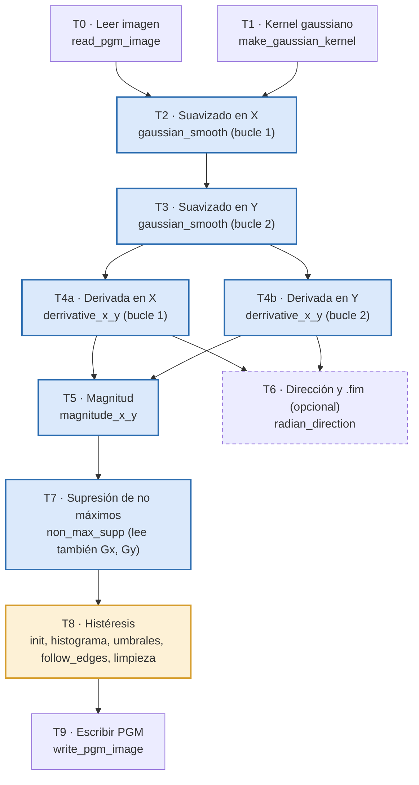

# Práctica 2 IC 2026-27 · Estudio y propuesta de paralelización del detector de bordes de Canny

Ingeniería de los Computadores · Universidad de Alicante · Curso 2026-27

Este README reúne **todo lo que hay que saber de la práctica**:

- qué pide el enunciado y qué hemos hecho para cada punto;
- cómo compilar, ejecutar y medir;
- qué ha salido en las mediciones;
- cómo explicarlo si el profesor pregunta.

La memoria completa está en un documento aparte (ver [Entrega](#14-entrega-checklist)).

---

## Índice

1. [Qué pide la práctica (resumen del enunciado)](#1-qué-pide-la-práctica-resumen-del-enunciado)
2. [El problema elegido: detector de bordes de Canny](#2-el-problema-elegido-detector-de-bordes-de-canny)
3. [Procedencia del código y qué hemos cambiado](#3-procedencia-del-código-y-qué-hemos-cambiado)
4. [Estructura del repositorio](#4-estructura-del-repositorio)
5. [Preparar el entorno (Linux / WSL)](#5-preparar-el-entorno-linux--wsl)
6. [Compilar y ejecutar: Makefile](#6-compilar-y-ejecutar-makefile)
7. [Cómo funciona el programa por dentro (fase a fase)](#7-cómo-funciona-el-programa-por-dentro-fase-a-fase)
8. [Grafo de dependencias y paralelismo (apartado 2.1)](#8-grafo-de-dependencias-y-paralelismo-apartado-21)
9. [Datos y accesos a memoria (apartado 2.2)](#9-datos-y-accesos-a-memoria-apartado-22)
10. [Mediciones: metodología y resultados (apartados 2.3 a 2.6)](#10-mediciones-metodología-y-resultados-apartados-23-a-26)
11. [Propuesta de arquitecturas paralelas y estimación de la ganancia](#11-propuesta-de-arquitecturas-paralelas-y-estimación-de-la-ganancia)
12. [Tarea 3: problemas de los grifos](#12-tarea-3-problemas-de-los-grifos)
13. [Preguntas que nos pueden hacer (y respuestas)](#13-preguntas-que-nos-pueden-hacer-y-respuestas)
14. [Entrega: checklist](#14-entrega-checklist)
15. [Glosario rápido](#15-glosario-rápido)
16. [Bibliografía](#16-bibliografía)

---

## 1. Qué pide la práctica (resumen del enunciado)

Hay que elegir una aplicación **secuencial en C/C++** con un coste computacional apreciable, estudiarla y **proponer** cómo paralelizarla. **La implementación paralela no se hace en esta práctica**, sino en las siguientes.

| Tarea del enunciado | Qué pide | Dónde lo tenemos |
| --- | --- | --- |
| **Tarea 1.** Selección | Una aplicación con **paralelismo de datos y funcional**, que se ejecute **sin intervención**, con un caso de prueba de **varios segundos a decenas de segundos** | Canny ([§2](#2-el-problema-elegido-detector-de-bordes-de-canny)). Caso de referencia de 8,1 s ([§6](#6-compilar-y-ejecutar-makefile)) |
| **2.1** Tareas y dependencias | Grafo de dependencias. Qué tareas pueden ir a la vez. Relación con el código | [§8](#8-grafo-de-dependencias-y-paralelismo-apartado-21) |
| **2.2** Datos y memoria | Estructuras importantes, patrones de acceso, caché, accesos compartidos | [§9](#9-datos-y-accesos-a-memoria-apartado-22) |
| **2.3** Tamaño del problema | Variar parámetros de carga y representar el tiempo secuencial | [§10.2](#102-escalado-con-el-tamaño-de-la-imagen) y [§10.3](#103-escalado-con-σ-sigma) |
| **2.4** Compilación y autovectorización | Varias opciones de gcc, tabla de tiempos, comandos usados y evidencias de SIMD | [§10.4](#104-opciones-de-compilación) y [§10.5](#105-autovectorización-evidencias) |
| **2.5** Comparación | Gráfica, ganancia frente a una compilación de referencia y explicación | [§10.4](#104-opciones-de-compilación) |
| **2.6** Interpretación | Qué limita el tiempo. Diferenciar mejoras **medidas** de ganancias paralelas **estimadas** | [§10.6](#106-interpretación-qué-limita-el-rendimiento) |
| **Tarea 3** | Problemas de los grifos (tiempo, ganancia, eficiencia) | [§12](#12-tarea-3-problemas-de-los-grifos) |
| **Tarea 4** | Memoria con 11 puntos, código fuente y **Makefile** con `make`, `make run` y `make clean` | [§14](#14-entrega-checklist) |

**Plazo:** entrega por **UACloud antes de la sesión de prácticas de la semana del 12 de octubre**. El grupo de los viernes entrega más tarde por el festivo del 9 d'octubre. La hora exacta y los formatos los indica la actividad de entrega.

**Originalidad:** el trabajo tiene que ser nuestro. Se puede usar código externo si está permitido, citándolo y explicando qué hemos aportado ([§3](#3-procedencia-del-código-y-qué-hemos-cambiado)).

---

## 2. El problema elegido: detector de bordes de Canny

El **detector de bordes de Canny** (John Canny, 1986) recibe una imagen en escala de grises y devuelve otra con sus **contornos**: los píxeles de borde salen en negro (0) y el resto en blanco (255). Es uno de los algoritmos clásicos de visión por computador.

Tiene cinco etapas encadenadas:

1. **Suavizado gaussiano.** Elimina el ruido con un filtro gaussiano separable: primero en X y luego en Y. El tamaño de la ventana depende de **σ (sigma)**, y vale `1 + 2·⌈2,5σ⌉` coeficientes (17 con σ = 3).
2. **Derivadas en X e Y.** Calcula el gradiente con las diferencias `[-1 0 +1]` en horizontal y en vertical.
3. **Magnitud del gradiente.** `sqrt(dx² + dy²)` en cada píxel.
4. **Supresión de no máximos (NMS).** Solo se queda con los píxeles que son máximo local **en la dirección del gradiente**. Así los bordes quedan de un píxel de grosor.
5. **Umbralización con histéresis.**
   - Calcula dos umbrales (alto y bajo) a partir del **histograma** de la magnitud.
   - Marca como borde lo que supera el umbral alto.
   - Después **sigue los contornos** (`follow_edges`, recursiva) por los píxeles que superan el umbral bajo.

**Por qué encaja con la práctica**
- **Paralelismo de datos:** las etapas 1 a 4 hacen la misma operación en cada píxel usando solo sus vecinos.
- **Paralelismo funcional:** la derivada en X y la derivada en Y son tareas distintas e independientes. El cálculo opcional de la dirección del gradiente se puede solapar con la magnitud, la NMS y la histéresis.
- **Dificultades reales para la memoria:** el histograma compartido, una recursión irregular, una dependencia entre iteraciones en la NMS y un acceso a memoria malo en el suavizado en Y.

---

## 3. Procedencia del código y qué hemos cambiado

### Origen

- **Repositorio de partida:** [AguilarTarazi/Canny](https://github.com/AguilarTarazi/Canny/tree/master), commit `1ff8457106ff0e23ee48e1f8e19d94dc2d9e255b`. Es el que presentamos al profesor. No declara licencia, así que lo usamos con fines docentes y citándolo.
- **Autor original del algoritmo en C:** **Mike Heath** (University of South Florida, 1996), a partir de código de Michigan State University. Lo distribuía como tres archivos: `canny_edge.c`, `hysteresis.c` y `pgm_io.c`.
- **Lo que cambió Pedro Tarazi en ese repo:**
  - unió los tres archivos en `canny.c`;
  - añadió tiempos por fase con `clock()`;
  - reescribió la derivada en Y como un bucle lineal;
  - fijó el nombre de salida en `imagen_serial.pgm`.
- **Lo que NO usamos:** `canny_openmp.c`, `canny_mpi.c`, `canny_mpi2.c` y la carpeta `Mas/` de ese repo. Son versiones paralelas, que corresponden a las prácticas siguientes.

### Nuestras modificaciones

La copia sin tocar está en [`original/canny.c`](original/canny.c). Con `diff original/canny.c canny.c` se ve exactamente qué hemos cambiado.

| Cambio | Dónde | Por qué |
| --- | --- | --- |
| `clock()` sustituido por `clock_gettime(CLOCK_MONOTONIC)`, a través de la función `now()` | Todo `canny.c` | `clock()` mide **tiempo de CPU**. En un programa paralelo suma el tiempo de todas las hebras y no sirve para calcular ganancias. Necesitamos **tiempo real** (*wall-clock*). |
| Nueva línea `Tiempo canny() (sin E/S)` | `main()` | Separa el cálculo de la lectura y escritura de la imagen. |
| Variante `-DBLUR_Y_FILAS` (bucles intercambiados en el suavizado en Y) | `gaussian_smooth()` | Medir el efecto de recorrer la memoria por filas en lugar de por columnas. **Sin la macro, el código es el original.** El resultado es idéntico byte a byte (comprobado con `cmp`). |
| `gen_pgm.c` (nuevo, hecho por nosotros) | Archivo aparte | El repo no trae imágenes (su `.gitignore` excluye los `.pgm`). Genera una imagen sintética reproducible de cualquier tamaño. |
| `Makefile`, `bench.sh` y `analiza.py` (nuevos) | Archivos aparte | `make`, `make run`, `make clean`, la batería de mediciones y el resumen estadístico. |

---

## 4. Estructura del repositorio

```
.
├── README.md               ← este archivo
├── Makefile                ← make / make run / make clean
├── canny.c                 ← Canny secuencial (con nuestras modificaciones)
├── original/canny.c        ← copia sin tocar del repo de partida (para comparar)
├── gen_pgm.c               ← generador de imágenes PGM de prueba (propio)
├── bench.sh                ← todas las mediciones (escalado, compilación, vectorización, gprof)
├── analiza.py              ← medianas de las mediciones → resultados/resumen_*.csv
└── resultados/
    ├── entorno.txt               ← CPU, cachés, RAM, kernel y versión de gcc
    ├── escalado.csv              ← tiempos por fase al variar el tamaño y σ (5 repeticiones)
    ├── compilacion.csv           ← tiempos por fase con 12 configuraciones de gcc (5 repeticiones)
    ├── resumen_escalado.csv      ← medianas (las genera analiza.py)
    ├── resumen_compilacion.csv   ← medianas (las genera analiza.py)
    ├── comandos.txt              ← comando exacto de cada compilación
    ├── verificacion.txt          ← qué compilaciones dan la MISMA imagen que -O2
    ├── vec_O2.txt                ← informe -fopt-info-vec-optimized con -O2
    ├── vec_O3_native.txt         ← informe -fopt-info-vec-optimized con -O3 -march=native
    ├── vec_O3_native_missed.txt  ← por qué NO se vectoriza cada bucle
    ├── canny_O3_native.s         ← ensamblador generado (para ver las instrucciones SIMD)
    └── gprof.txt                 ← perfil por funciones
```

---

## 5. Preparar el entorno (Linux / WSL)

El enunciado pide compilar con **GCC en Linux**. Si trabajas en Windows, usa **WSL** (Windows Subsystem for Linux).

### En Windows (WSL)

1. Si no tienes WSL, abre PowerShell como administrador y ejecuta `wsl --install -d Ubuntu-24.04`. Reinicia, abre "Ubuntu" y crea tu usuario.
2. Dentro de Ubuntu, instala las herramientas:
   ```bash
   sudo apt update
   sudo apt install build-essential git python3
   ```
   Con eso ya tienes `gcc`, `make`, `gprof`, `taskset` y `cmp`.
3. Las carpetas de Windows se ven en `/mnt/c/...`. Por ejemplo:
   ```bash
   cd "/mnt/c/Users/<usuario>/Desktop/curso2026-2027/PRIMER CUATRI/IC/practica 2 ic"
   ```
   Las comillas hacen falta por los espacios.
4. **Recomendado para medir:** clonar el repo dentro del disco de Linux (`~/practica2`) en lugar de `/mnt/c`. Leer ficheros desde `/mnt/c` es lento y mete ruido en las medidas. `bench.sh` ya lo resuelve trabajando en `/tmp`.

### Avisos normales que vas a ver

- **`make: warning: Clock skew detected`:** salen al trabajar en `/mnt/c`, porque los relojes de Windows y de Linux no coinciden exactamente. No afectan.
- **`'gy' may be used uninitialized`** y similares en `non_max_supp`: vienen del **código original** y son una evidencia de la dependencia entre iteraciones que explicamos en [§8](#dificultades-para-paralelizar).
- **`ignoring return value of 'fgets'`:** aparecen con `-O3`. Son inofensivos y también vienen del código original.

### Clonar el repo

```bash
git clone <URL-del-repo> practica2
cd practica2
```

---

## 6. Compilar y ejecutar: Makefile

### Objetivos obligatorios

| Comando | Qué hace |
| --- | --- |
| `make` | Compila `canny` (con `-O2 -Wall`) y `gen_pgm` |
| `make run` | Genera la imagen de referencia si no existe y ejecuta el **caso de prueba de referencia** |
| `make clean` | Borra los ejecutables, las imágenes generadas, los `.fim`, los `.s` y `gmon.out` |

### Caso de prueba de referencia

| Parámetro | Valor |
| --- | --- |
| Imagen | `gen_pgm 12000 12000 42`: 12000 × 12000 píxeles (144 Mpx, 137 MiB) |
| σ / tlow / thigh | 3,0 / 0,3 / 0,8 (ventana gaussiana de 17 coeficientes) |
| Compilación de referencia | `gcc -O2 canny.c -o canny -lm` |
| Tiempo total | **≈ 8,1 s** (mediana de 5) |
| Tiempo de `canny()` sin E/S | **≈ 7,7 s** |
| Memoria máxima | **1,48 GiB** (medida con `/usr/bin/time -v`) |

`make run` primero tarda unos segundos en generar `imagen_12000.pgm` y luego ejecuta. En nuestra máquina la salida termina así:
```
Tiempo canny() (sin E/S): 7.6204 segundos
Tiempo total del programa: 8.7356 segundos
```
Las primeras veces el tiempo total puede salir algo mayor que en `bench.sh`, porque aquí se lee y se escribe en `/mnt/c`.

### Variables que se pueden cambiar sin tocar el Makefile

```bash
make run SIZE=4000            # imagen de 4000x4000 (más rápido para probar)
make run SIGMA=1.5            # otro sigma
make run TLOW=0.4 THIGH=0.9   # otros umbrales
make clean && make CFLAGS="-O3 -march=native"            # otras opciones de compilación
make clean && make CFLAGS="-O2 -DBLUR_Y_FILAS"           # nuestra variante del suavizado en Y
```

### Ejecutar a mano

```bash
./gen_pgm ancho alto semilla salida.pgm          # p. ej. ./gen_pgm 8000 8000 42 img.pgm
ulimit -s unlimited                              # IMPORTANTE (ver abajo)
./canny imagen.pgm sigma tlow thigh [writedirim]
```

- **Salida:** siempre se escribe en `imagen_serial.pgm` (P5, en escala de grises). Se puede abrir con GIMP o IrfanView, o convertirla con ImageMagick si está instalado.
- **5.º argumento opcional (`writedirim`):** si se pasa cualquier valor, el programa también escribe la **dirección del gradiente** en un fichero `<imagen>_s_..._.fim` de floats. Es la tarea T6 del grafo.
- **`ulimit -s unlimited`:** `follow_edges` es **recursiva**. En imágenes grandes, un contorno largo puede desbordar la pila de 8 MiB que hay por defecto y dar *segmentation fault*. `make run` y `bench.sh` ya lo hacen.

### Qué significan las líneas que imprime

```
==================== Gaussian_Smooth ===================
Tiempo primer bloque serial:   ...   ← suavizado en X (T2)
Tiempo segundo bloque serial:  ...   ← suavizado en Y (T3)
Tiempo total funcion:          ...   ← T1 + T2 + T3 + reservas de memoria
===================== Derivate_x_y =====================
Tiempo primer bloque serial:   ...   ← derivada en X (T4a)
Tiempo segundo bloque serial:  ...   ← derivada en Y (T4b)
===================== Non_Max_Supp =====================
Tiempo bloque serial:          ...   ← NMS (T7)
==================== Appy_Hysteresis ===================
Tiempo primer bloque serial:   ...   ← inicializar edge
Tiempo segundo bloque serial:  ...   ← histograma
Tiempo tercer bloque serial:   ...   ← follow_edges (seguimiento recursivo)
Tiempo cuarto bloque serial:   ...   ← limpieza final
Tiempo canny() (sin E/S):      ...   ← todo el cálculo
Tiempo total del programa:     ...   ← cálculo + lectura + escritura
```

`magnitude_x_y` (T5) no tiene cronómetro propio. Está incluida en `canny()`, y gprof dice que son unos 0,47 s.

### Repetir todas las mediciones

```bash
./bench.sh            # unos 15-20 minutos; deja todo en resultados/
REPS=3 ./bench.sh     # menos repeticiones
python3 analiza.py    # medianas → resultados/resumen_*.csv y por pantalla
```

`bench.sh` hace lo siguiente:

1. Copia el código a `/tmp/canny_bench`, compila allí y fija el proceso al núcleo 2 (`taskset -c 2`).
2. Repite cada caso 5 veces.
3. Mide el escalado (6 tamaños y 7 valores de σ) y 12 configuraciones de compilación.
4. Comprueba con `cmp` si la imagen de salida coincide con la de `-O2`.
5. Genera los informes de vectorización, el ensamblador y el perfil de gprof.

---

## 7. Cómo funciona el programa por dentro (fase a fase)

Los números de línea se refieren al `canny.c` del repo, que es el modificado.

| Tarea | Función (línea aprox.) | Qué hace exactamente |
| --- | --- | --- |
| T0 | `read_pgm_image` (≈1012) | Lee la cabecera `P5`, ancho, alto y 255, y luego `rows·cols` bytes con `fread`. |
| T1 | `make_gaussian_kernel` (≈557) | Crea un kernel 1D de `1+2·⌈2,5σ⌉` coeficientes y lo normaliza para que sume 1. |
| T2 | `gaussian_smooth`, 1.er bucle (≈497) | Para cada píxel hace `dot += image[r*cols+c+cc]·kernel[...]` dentro de la ventana y escribe `tempim` (float). El `if` dentro del bucle comprueba los bordes de la imagen. |
| T3 | `gaussian_smooth`, 2.º bucle (≈518-540) | Lo mismo en vertical sobre `tempim`. Escribe `smoothedim` (short), multiplicando por `BOOSTBLURFACTOR = 90`. **Original: `c` fuera y `r` dentro, recorrido por columnas.** |
| T4a | `derrivative_x_y` (≈405) | `delta_x[pos] = smooth[pos+1] − smooth[pos−1]`. El nombre de la función lleva doble "r" en el original. |
| T4b | `derrivative_x_y` (≈434-439) | `delta_y[r] = smooth[r+cols] − smooth[r−cols]`, en un bucle lineal. |
| T5 | `magnitude_x_y` (≈341) | `mag = (short)(0.5 + sqrt(dx² + dy²))`. |
| T6 | `radian_direction` (≈278), opcional | `atan` por píxel y escritura del `.fim`. Solo con el 5.º argumento. |
| T7 | `non_max_supp` (≈780) | Para cada píxel compara la magnitud con dos interpolaciones de sus vecinos según el octante del gradiente (8 casos). Marca `POSSIBLE_EDGE` (128) o `NOEDGE` (255). |
| T8 | `apply_hysteresis` (≈641) + `follow_edges` (≈612) | Inicializa `edge` y pone el borde a NOEDGE. Calcula el histograma de la magnitud y obtiene el umbral alto como el percentil `thigh` y el bajo como `tlow·alto`. Sigue contornos recursivamente desde cada píxel por encima del umbral alto. Al final limpia: lo que no es `EDGE` pasa a `NOEDGE`. |
| T9 | `write_pgm_image` (≈1071) | Escribe `imagen_serial.pgm`. |

---

## 8. Grafo de dependencias y paralelismo (apartado 2.1)

GitHub dibuja este grafo automáticamente (Mermaid):



Leyenda: azul = paralelismo de datos por píxel; amarillo = difícil de paralelizar; discontinuo = opcional (5.º argumento).

Solo se dibujan las **dependencias directas**. T7 también lee Gx y Gy, y T8 también lee la magnitud, pero el orden de la cadena ya garantiza que estén listas.

### Paralelismo de datos

T2, T3, T4a, T4b, T5 y T7 calculan **cada píxel de salida a partir de una vecindad fija de la entrada** y no escriben nada compartido.

- **Reparto:** se pueden dividir en **franjas de filas**, una por hebra.
- **Borde de solape (*halo*):** cada franja necesita leer algunas filas de la vecina: `center` filas en T3 (8 con σ = 3) y una fila en T4b y T7.

### Paralelismo funcional

| Tareas que pueden ir a la vez | Por qué son independientes |
| --- | --- |
| **T0 ∥ T1** | El kernel solo depende de σ, no de la imagen. La ganancia es pequeña. |
| **T4a ∥ T4b** | Las dos leen `smoothedim` (solo lectura) y escriben vectores distintos (`delta_x` y `delta_y`). |
| **T6 ∥ (T5 → T9)** | La dirección y el `.fim` solo necesitan Gx y Gy. Pueden solaparse con todo lo que viene después. |
| **T2 → T3 en cadena (*pipeline*)** | La fila r del suavizado en Y solo necesita las filas `r−center … r+center` del suavizado en X. |

### Dificultades para paralelizar

1. **Histograma (T8):** `hist[mag[pos]]++` es una **reducción** en posiciones que dependen del dato. Si varias hebras escriben a la vez hay **carreras**. Solución: un histograma privado por hebra y sumarlos al final.
2. **`follow_edges` (T8):** es **recursiva** y sigue contornos por toda la imagen.
   - Su trabajo depende del contenido de la imagen y está mal repartido.
   - Los contornos cruzan franjas.
   - Es la parte más secuencial del programa. Solución posible: contornos locales en cada franja y después unir los que tocan los bordes.
3. **Dependencia entre iteraciones en la NMS (T7):** si `m00 == 0`, el código **no actualiza** `gx`, `gy`, `xperp` ni `yperp`, pero **sigue usándolos**.
   - El resultado de ese píxel depende entonces del píxel anterior.
   - gcc lo avisa con `'gy' may be used uninitialized`.
   - Viene del código original de Heath.
   - En paralelo, una hebra que empieza a mitad de fila tendría valores distintos y **la salida podría no coincidir con la secuencial**. Hay que comprobarlo con `cmp` o corregirlo inicializando esas variables en cada píxel.

---

## 9. Datos y accesos a memoria (apartado 2.2)

| Estructura | Tipo (B/píxel) | La escribe | La leen | Cómo se accede |
| --- | --- | --- | --- | --- |
| `image` | `unsigned char` (1) | T0 | T2 | por filas, ventana horizontal ±`center` |
| `kernel` | `float[17]` (σ=3) | T1 | T2, T3 | siempre en L1 |
| `tempim` | `float` (4) | T2 | T3 | **por columnas (salto de cols·4 = 48 KB)** |
| `smoothedim` | `short` (2) | T3 | T4a, T4b | T3 escribe por columnas; T4 lee contiguo |
| `delta_x`, `delta_y` | `short` (2+2) | T4a, T4b | T5, T6, T7 | contiguo |
| `magnitude` | `short` (2) | T5 | T7, T8 | T7 lee una vecindad 3×3 (3 filas a la vez) |
| `nms` | `unsigned char` (1) | T7 | T8 | contiguo |
| `edge` | `unsigned char` (1) | T8 | T8, T9 | 5 pasadas completas y accesos sueltos desde `follow_edges` |
| `hist` | `int[32768]` (128 KiB, en pila) | T8 | T8 | posiciones que dependen del dato; cabe en L2 |
| `dir_radians` | `float` (4) | T6 | se escribe en el `.fim` | contiguo |

**Memoria máxima:** unos **11 B por píxel** durante la histéresis (15 B con el `.fim`). En el caso de referencia son **1,48 GiB medidos**, unas 50 veces la L3 de 32 MiB. Por eso cada fase vuelve a traer sus datos desde la memoria principal.

### El problema del suavizado en Y (clave para la defensa)

```c
for(c=0;c<cols;c++)            // ORIGINAL: columnas fuera
   for(r=0;r<rows;r++)         //           filas dentro
      for(rr=-center; rr<=center; rr++)
         dot += tempim[(r+rr)*cols+c] * kernel[center+rr];
```

- Cada lectura salta `cols` posiciones: 12 000 floats, es decir, 48 KB.
- **Cada acceso cae en una línea de caché distinta y en otra página de 4 KiB.** La TLB también sufre.
- Una línea de 64 B trae 16 columnas, pero la columna siguiente se procesa **12 000 filas después**. Para entonces la línea ya ha salido de L1 y L2 (12 000 líneas son 750 KiB, más que la L2 de 512 KiB), aunque sigue en la L3.
- **Nuestra propuesta (`-DBLUR_Y_FILAS`):** intercambiar los dos bucles exteriores para recorrer por filas. Cada píxel suma los mismos términos en el mismo orden, así que el resultado es **idéntico**. **Medido: el suavizado en Y pasa de 2,18 s a 1,85 s (−15 %).**

### Otras reorganizaciones (propuestas, no medidas)

- **Fusionar T4a + T4b + T5** (y T6) en una pasada: Gx, Gy y la magnitud se calculan juntos para cada píxel. `smoothedim` se lee una vez y `delta_x` y `delta_y` no se releen en T5.
- **Procesar por franjas** que quepan en L2 o L3, con su *halo*. Toda la cadena T2 a T7 trabajaría con datos en caché, y además es la forma natural de repartir entre hebras.
- **Separar el borde de la imagen del interior** en el suavizado. Sin el `if` dentro del bucle interior, gcc podría vectorizarlo.

### Accesos compartidos en una versión paralela

- **Franjas de filas:** las hebras solo comparten las filas de borde, que se leen pero no se modifican. Puede haber **compartición falsa** (*false sharing*) en la línea donde termina una franja y empieza otra, pero es despreciable con filas de 12 000 B.
- **`hist` compartido:** carreras de datos. Hace falta una copia privada por hebra.
- **`edge` en `follow_edges`:** escrituras que cruzan franjas. Hacen falta sincronización o el esquema en dos fases.
- **Ancho de banda:** las fases ligeras (derivadas, magnitud, inicialización de la histéresis) mueven muchos bytes por cada operación. Con 8 núcleos, el ancho de banda de memoria acabará limitándolas.

---

## 10. Mediciones: metodología y resultados (apartados 2.3 a 2.6)

### 10.1 Entorno y metodología

| | |
| --- | --- |
| CPU | **AMD Ryzen 7 5800X** (Zen 3), 8 núcleos y 16 hilos, con AVX2 y FMA (sin AVX-512) |
| Cachés | L1d 32 KiB y L2 512 KiB por núcleo; L3 de 32 MiB compartida |
| RAM | 32 GiB |
| SO | Ubuntu 24.04 sobre WSL2 (kernel 6.6.87), Windows 11 |
| Compilador | gcc 13.3.0 |

- **5 repeticiones** por caso; usamos la **mediana**.
- Mismo núcleo en todas las ejecuciones (`taskset -c 2`), para que el proceso no cambie de núcleo.
- Medimos con `CLOCK_MONOTONIC`. La métrica principal es el **tiempo de `canny()` sin E/S**.
- Trabajamos en `/tmp`, el disco de Linux, para que la E/S de `/mnt/c` no meta ruido.
- Imágenes de `gen_pgm`, siempre con la semilla 42.
- **Ruido entre ejecuciones:** hasta un ±5 %, y algún caso aislado hasta el 10 %. Las diferencias menores del 5 % no son significativas.

### 10.2 Escalado con el tamaño de la imagen

σ = 3, `-O2`, mediana de 5 ejecuciones, tiempos en segundos:

| Tamaño | Mpx | Suav. X | Suav. Y | Derivadas | NMS | Histéresis | **canny()** | ns/píxel |
| --- | --- | --- | --- | --- | --- | --- | --- | --- |
| 2000² | 4 | 0,061 | 0,054 | 0,011 | 0,032 | 0,023 | **0,195** | 48,7 |
| 4000² | 16 | 0,245 | 0,216 | 0,046 | 0,128 | 0,097 | **0,810** | 50,6 |
| 6000² | 36 | 0,574 | 0,507 | 0,104 | 0,305 | 0,224 | **1,908** | 53,0 |
| 8000² | 64 | 1,060 | 0,987 | 0,191 | 0,535 | 0,409 | **3,486** | 54,5 |
| 10000² | 100 | 1,639 | 1,475 | 0,298 | 0,830 | 0,637 | **5,426** | 54,3 |
| 12000² | 144 | 2,336 | 2,149 | 0,446 | 1,213 | 0,942 | **7,774** | 54,0 |

**Qué se observa:**
- **El tiempo es lineal con el número de píxeles.** Hay 36 veces más píxeles y el tiempo se multiplica por 40.
- **El coste por píxel sube un poco (de 48,7 a 54 ns) y se estabiliza a partir de 8000².** Con 2000², `image` y `tempim` (unos 20 MiB) caben en la L3 de 32 MiB. A partir de 4000² ya no, y todas las fases trabajan contra la memoria principal.
- **El reparto entre fases no cambia con el tamaño.** El suavizado es siempre el 58 % y ninguna fase crece peor que de forma lineal.
- La diferencia entre `canny()` y la suma de las fases (unos 0,7 s en 12000²) es la magnitud, que no tiene cronómetro, más las reservas de memoria con `calloc`.

### 10.3 Escalado con σ (sigma)

Imagen de 8000², `-O2`, tiempos en segundos:

| σ | Ventana | Suav. X | Suav. Y | NMS | Histéresis | **canny()** |
| --- | --- | --- | --- | --- | --- | --- |
| 0,5 | 5 | 0,429 | 0,679 | 1,007 | 0,880 | **3,560** |
| 1 | 7 | 0,502 | 0,661 | 0,772 | 0,908 | **3,312** |
| 2 | 11 | 0,677 | 0,735 | 0,625 | 0,538 | **3,061** ← mínimo |
| 3 | 17 | 1,000 | 0,915 | 0,536 | 0,406 | **3,356** |
| 4 | 21 | 1,137 | 1,099 | 0,480 | 0,318 | **3,525** |
| 6 | 31 | 1,633 | 1,458 | 0,509 | 0,290 | **4,371** |
| 8 | 41 | 2,069 | 1,826 | 0,562 | 0,308 | **5,291** |

**Qué se observa (es uno de los resultados más interesantes):**
- **El suavizado en X crece casi lineal con la ventana:** más coeficientes, más multiplicaciones por píxel.
- **El suavizado en Y apenas cambia con ventanas pequeñas** (0,68 → 0,73 s hasta σ = 2) y es **más lento que el de X** con σ pequeño. Con pocas operaciones, lo que domina son los **fallos de caché por recorrer columnas**, no el cálculo.
- **NMS e histéresis BAJAN al subir σ** (1,89 s → 0,87 s). Una imagen más suavizada tiene **menos candidatos a borde**, así que `follow_edges` y la NMS hacen menos trabajo.
- **El total no es monótono: el mínimo está en σ = 2.** El coste de la histéresis **depende del contenido de la imagen**, no solo de su tamaño, y eso importa para repartir la carga en paralelo.
- **Las derivadas** valen siempre unos 0,18 s, porque su trabajo por píxel es fijo.

### 10.4 Opciones de compilación

Caso de referencia (12000², σ = 3). La **referencia es `-O2`**. S = t(-O2) / t(config). Comando: `gcc <opciones> canny.c -o canny_<nombre> -lm` (lista exacta en `resultados/comandos.txt`).

| Opciones | canny() mediana (s) | Rango (s) | **S** | ¿Imagen igual que -O2? |
| --- | --- | --- | --- | --- |
| `-O0` | 21,40 | 21,18 – 22,66 | **0,36** | sí |
| `-O1` | 7,61 | 7,52 – 7,66 | 1,02 | sí |
| `-O2` (referencia) | 7,74 | 7,48 – 7,89 | 1,00 | — |
| `-O2 -fno-tree-vectorize` | 7,81 | 7,56 – 7,97 | 0,99 | sí |
| `-O3` | 7,35 | 7,31 – 7,48 | 1,05 | sí |
| `-O3 -funroll-loops` | 6,93 | 6,89 – 7,60 | **1,12** | sí |
| `-O3 -march=native` | 7,10 | 6,95 – 7,20 | 1,09 | **NO** (42 745 B) |
| `-O3 -march=native -ffp-contract=off` | 7,11 | 6,86 – 7,44 | 1,09 | sí |
| `-O3 -march=native -flto` | 7,59 | 7,51 – 7,65 | 1,02 | **NO** |
| `-Ofast -march=native` | 7,50 | 7,32 – 7,94 | 1,03 | **NO** (54 125 B) |
| `-O2 -DBLUR_Y_FILAS` | 7,34 | 7,18 – 7,44 | 1,05 | sí |
| `-O3 -march=native -DBLUR_Y_FILAS` | **6,79** | 6,70 – 6,84 | **1,14** | NO (por las FMA) |

**Qué hace cada opción:**

| Opción | Qué hace |
| --- | --- |
| `-O0` | Sin optimizar: cada variable se lee y se escribe en memoria en cada uso. |
| `-O1` | Optimizaciones básicas: registros, propagación de constantes, eliminación de código muerto. |
| `-O2` | Añade planificación de instrucciones e *inlining* moderado. **Desde gcc 12 también vectoriza**, pero con el modelo de coste *very-cheap*, que casi nunca se activa. |
| `-fno-tree-vectorize` | Desactiva la vectorización automática de bucles. |
| `-O3` | Vectorización con el modelo de coste completo, *inlining* agresivo y clonado de funciones. |
| `-funroll-loops` | Desenrolla bucles: menos saltos y comparaciones por iteración. |
| `-march=native` | Genera código para la CPU donde se compila (Zen 3): **AVX2** (vectores de 256 bits), **FMA** y BMI2. |
| `-ffp-contract=off` | Prohíbe fusionar `a*b + c` en una instrucción FMA. |
| `-flto` | Optimización en tiempo de enlace. Aquí apenas aporta, porque solo hay un fichero. |
| `-Ofast` | `-O3` más `-ffast-math`: reordena operaciones en coma flotante y no respeta IEEE 754. |
| `-DBLUR_Y_FILAS` | Nuestra macro: suavizado en Y recorriendo por filas. |

**Interpretación por fases** (datos en `resultados/resumen_compilacion.csv`):
- **`-O0` es 2,8 veces más lento.** Sin asignación de registros, `dot` y `sum` van a memoria en cada iteración del bucle del kernel.
- **Las derivadas** son lo más vectorizable: 0,42 s con `-O2`, 0,35 s con `-O3 -march=native`.
- **`follow_edges` baja un 40 % con `-O3`** (0,47 → 0,28 s). Lo atribuimos al *inlining* parcial de la recursión: gprof cuenta 291 711 llamadas.
- **El suavizado tarda unos 4,4 s en TODAS las configuraciones.** gcc no lo vectoriza (por el `if` de límites) y eso limita cuánto puede ayudar el compilador.
- **`-flto` y `-Ofast` hacen más lento el suavizado en Y** (2,1 → 2,6 s). Lo repetimos dos veces más y se reproduce. Creemos que se debe al código que generan para ese bucle, **pero no lo hemos analizado**. Si el profesor pregunta, decirlo así.
- **`-march=native` CAMBIA LA SALIDA.** gcc fusiona `dot += a*b` en una **FMA** (*fused multiply-add*), que redondea una vez en lugar de dos. Las pequeñas diferencias en `float` cambian algún redondeo a `short` y algún borde. Lo comprobamos de dos formas:
  - `-O2 -mfma` da **exactamente** la misma diferencia (42 745 bytes);
  - `-O3 -march=native -ffp-contract=off` vuelve a dar la imagen **idéntica**, y en el mismo tiempo (7,11 s frente a 7,10 s).
  - **Conclusión:** las FMA no aceleran este programa, solo cambian el resultado.
  - **Lección:** al optimizar, y también al paralelizar, hay que verificar siempre que la salida es la misma (`cmp`).

### 10.5 Autovectorización: evidencias

Informe de `gcc -O3 -march=native -fopt-info-vec-optimized` (en `resultados/vec_O3_native.txt`):

| Línea | Código | Tarea | Vector |
| --- | --- | --- | --- |
| 407 | `delta_x[pos] = smoothedim[pos+1] - smoothedim[pos-1]` | T4a | 32 B (16 `short`) |
| 434, 436, 438 | `delta_y[r] = smoothedim[r+cols] - smoothedim[r-cols]` | T4b | 32 B |
| 578 | normalización del kernel | T1 | 32 B |
| 662 | `if(nms[pos]==POSSIBLE_EDGE) edge[pos]=…` | T8, inicialización | 32 B |
| 673 | bordes de `edge` | T8 | 32 B |
| 703 | `numedges += hist[r]` | T8, umbrales | 32 B (reducción) |
| 620 | inicialización de `x[8]` e `y[8]` | `follow_edges` | bloque básico (SLP) |

**Con `-O2`, gcc solo vectoriza el bloque básico de la línea 620** (`resultados/vec_O2.txt`). Por eso `-O2` y `-O2 -fno-tree-vectorize` tardan lo mismo.

**Evidencia en ensamblador.** Este es el bucle principal de la derivada en Y (línea 437) en `resultados/canny_O3_native.s`:

```asm
.L131:
    vmovdqu  (%rdi,%r10), %ymm7          # carga 16 short de smoothedim[r+cols]
    vpsubw   (%rbx,%r10), %ymm7, %ymm0   # resta 16 short de smoothedim[r-cols]
    vmovdqu  %ymm0, (%r8,%r10)           # guarda 16 resultados en delta_y
    addq     $32, %r10                   # avanza 32 bytes = 16 píxeles
    cmpq     %r10, %r11
    jne      .L131
```

- `vpsubw` = *vector packed subtract word*: **resta 16 enteros de 16 bits a la vez** en registros `ymm` de 256 bits (AVX2).
- Su versión escalar sería una resta por píxel. Las instrucciones escalares suelen llevar el sufijo `ss`/`sd`, y las empaquetadas `ps`/`pd`, o `p…` en el caso de los enteros.

Para buscar estas instrucciones uno mismo:
```bash
gcc -O3 -march=native -fopt-info-vec-optimized canny.c -o /dev/null -lm
gcc -O3 -march=native -S canny.c -o canny.s && grep -n "vpsubw\|ymm" canny.s | head
```

**Qué NO se vectoriza y por qué** (`resultados/vec_O3_native_missed.txt`):
- **Suavizado en X e Y** (líneas 501 y 530): *control flow in loop*, por el `if` que comprueba los límites dentro del bucle del kernel.
- **Magnitud** (línea 355): `sqrt` puede modificar `errno`. gcc genera `vsqrtsd`, escalar y en doble precisión. Con `-fno-math-errno` probablemente se vectorizaría (no lo hemos medido).
- **Histograma** (línea 693) y **limpieza** (línea 744): control de flujo.
- **NMS** (línea 814): 8 ramas por octante.
- **`follow_edges`**: es recursiva.

### 10.6 Interpretación: qué limita el rendimiento

Perfil de **gprof** (`-O2 -pg`, caso de referencia):

| Función | % tiempo | Paralelismo |
| --- | --- | --- |
| `gaussian_smooth` | **59,6 %** | datos |
| `non_max_supp` | 15,8 % | datos (vecindad 3×3) |
| `magnitude_x_y` | 6,3 % | datos |
| `derrivative_x_y` | 6,2 % | datos y funcional |
| `apply_hysteresis` (sin `follow_edges`) | 6,6 % | datos con reducción |
| `follow_edges` | 5,5 % | irregular, difícil |

- **Lo que más limita es el suavizado:** casi el 60 %. Crece con los píxeles y con σ, no se vectoriza, y en Y además recorre la memoria mal.
- **El 88 % del tiempo está en fases por píxel sin escrituras compartidas.** Es la parte fácil de paralelizar.
- **Mejoras MEDIDAS en la versión secuencial:**
  - `-O3 -funroll-loops`: S = 1,12;
  - bucle por filas con `-O3 -march=native`: S = 1,14;
  - el suavizado en Y baja un 15 % con el intercambio de bucles.
- **Mejoras ESTIMADAS (sin medir):** la fusión de fases, el procesado por franjas y la versión paralela ([§11](#11-propuesta-de-arquitecturas-paralelas-y-estimación-de-la-ganancia)). No hay que confundirlas con las medidas.

---

## 11. Propuesta de arquitecturas paralelas y estimación de la ganancia

### Estimación con la ley de Amdahl (ESTIMADA, no medida)

```
S(p) = 1 / ( f + (1 − f) / p )        E(p) = S(p) / p
```

Partimos del caso de referencia con `-O2` (8,06 s en total):

- **Escenario conservador, f ≈ 12 %:** son secuenciales la E/S (0,31 s), `follow_edges` (0,47 s) y las reservas de memoria (unos 0,15 s). (0,31 + 0,47 + 0,15) / 8,06 ≈ 0,115.
- **Escenario optimista, f ≈ 4 %:** `follow_edges` también se paraleliza y solo queda secuencial la E/S. 0,31 / 8,06 ≈ 0,04.

| p | S (f = 12 %) | E | S (f = 4 %) | E |
| --- | --- | --- | --- | --- |
| 2 | 1,79 | 0,89 | 1,92 | 0,96 |
| 4 | 2,94 | 0,74 | 3,57 | 0,89 |
| **8** | **4,35** | **0,54** | **6,25** | **0,78** |
| 16 | 5,71 | 0,36 | 10,0 | 0,63 |
| ∞ | 8,3 (límite) | — | 25 (límite) | — |

**Matices:**
- Pasar de 8 a 16 hebras es **SMT**: 2 hilos por núcleo sobre los **mismos 8 núcleos**. La ganancia real será bastante menor que la teórica.
- Amdahl **no tiene en cuenta el ancho de banda de memoria**, que limitará las fases ligeras.
- La creación de hebras y la sincronización también restarán algo.

### Arquitecturas

| Arquitectura | Cómo se reparte | Ventajas | Dificultades |
| --- | --- | --- | --- |
| **Multinúcleo con memoria compartida (OpenMP o pthreads)**, la recomendada para empezar | `#pragma omp parallel for` por franjas de filas (`schedule(static)`). T4a ∥ T4b y T6 con `sections` o `task`. | No hay que copiar datos. Cambios pequeños en el código. Es lo que haremos en las próximas prácticas. | Histograma privado por hebra. `follow_edges` cruza franjas. Ancho de banda compartido. Dependencia de la NMS. |
| **GPU (CUDA u OpenCL)** | Un hilo por píxel. Bloques de 16×16 con el *halo* en memoria compartida. | Miles de hilos para 144 Mpx. Mucho ancho de banda. Los filtros encajan muy bien (artículo de Luo y Duraiswami, 2008). | Copiar por PCIe. Sin recursión: la histéresis se hace con pasadas iterativas hasta que nada cambie. Las ramas de la NMS divergen entre hilos. |
| **Clúster (MPI)** | Franjas por proceso con intercambio de bordes, o **una imagen completa por nodo**. | Escala en memoria y en núcleos. Para **lotes de imágenes** no hace falta comunicarse. | Repartir 137 MiB por la red cuesta tanto como el cálculo. La histéresis necesita comunicación entre franjas. |
| **Heterogéneo (CPU con GPU)** | GPU para T2–T7 y CPU para T8 y la E/S, en cadena sobre una secuencia de imágenes. | Cada parte va a su mejor recurso y la E/S se solapa. | Hay que repartir en proporción a la velocidad de cada recurso (los grifos, [§12](#12-tarea-3-problemas-de-los-grifos)). Sincronización más compleja. |

### Plan para la siguiente práctica (OpenMP)

1. `#pragma omp parallel for` en los bucles externos de T2, T3, T4, T5 y T7. Usar la versión del suavizado en Y por filas, porque con columnas cada hebra tendría el mismo problema de caché.
2. `#pragma omp sections` para T4a ∥ T4b. O mejor, fusionarlas en un solo bucle paralelo.
3. Histograma: un `hist` privado por hebra y `reduction` o suma manual al final.
4. Inicializar `gx`, `gy`, `xperp` e `yperp` en cada píxel de la NMS.
5. Dejar `follow_edges` secuencial al principio. Después, probar el esquema por franjas con unión de contornos.
6. **Verificar siempre con `cmp imagen_serial.pgm referencia.pgm`** y medir el tiempo con 1, 2, 4, 8 y 16 hebras.

---

## 12. Tarea 3: problemas de los grifos

Cada grifo i llena el depósito en tᵢ horas, así que su caudal es 1/tᵢ depósitos por hora. Los caudales se suman.

```
T = 1 / Σ(1/tᵢ)        S = t_más_rápido / T        E = S / n
```

| Caso | Grifos (h) | Caudal total | **T (h)** | **S** | **E** |
| --- | --- | --- | --- | --- | --- |
| 1 | 8 y 40 | 1/8 + 1/40 = 6/40 | 40/6 ≈ **6,67** (6 h 40 min) | 8/6,67 = **1,2** | 1,2/2 = **0,60** |
| 2 | 8 y 8 | 2/8 | **4** | 8/4 = **2** | 2/2 = **1** |
| 3 | 40 y 40 | 2/40 | **20** | 40/20 = **2** | 2/2 = **1** |
| 4 | 8, 40 y 40 | 1/8 + 2/40 = 7/40 | 40/7 ≈ **5,71** (5 h 43 min) | 8/5,71 = **1,4** | 1,4/3 ≈ **0,47** |

**Explicación:**
- **Casos 2 y 3:** dos grifos iguales dan **ganancia 2 y eficiencia 1**, sean rápidos o lentos. Es el caso ideal de procesadores idénticos con la carga repartida a partes iguales.
- **Caso 1:** añadir un grifo **5 veces más lento** solo mejora un **20 %**. Aporta 1/5 del caudal del rápido, y la eficiencia baja a 0,6.
- **Caso 4:** un tercer grifo lento sube la ganancia a 1,4, pero la eficiencia **baja a 0,47**.
- **Relación con la paralelización:** es lo que pasa en un **sistema heterogéneo** (CPU con GPU, o núcleos de rendimiento con núcleos de eficiencia).
  - La ganancia se suma **en proporción a la velocidad** de cada recurso, y la eficiencia medida contra el recurso más rápido baja.
  - Además, para que salga así, el reparto debe ser **proporcional a la velocidad**. Si se reparte a partes iguales, todos esperan al más lento.

---

## 13. Preguntas que nos pueden hacer (y respuestas)

**¿Por qué Canny y no una multiplicación de matrices?**
Porque, además de paralelismo de datos (todo por píxel), tiene **paralelismo funcional real**: las derivadas X ∥ Y, la dirección ∥ el resto y el *pipeline* entre fases. También tiene dificultades interesantes: la reducción del histograma, la recursión irregular y la dependencia en la NMS. El enunciado pide expresamente algo más que paralelismo de datos.

**¿Por qué cambiasteis `clock()` por `clock_gettime`?**
`clock()` mide el tiempo de CPU del proceso. Con 8 hebras durante 1 s marcaría unos 8 s, y la ganancia saldría falsa. `CLOCK_MONOTONIC` mide tiempo real y no se ve afectado si cambia la hora del sistema.

**¿Cómo se ejecuta sin intervención?**
Todos los parámetros van por la línea de comandos y la salida a un fichero. `make run` lo hace todo, incluida la generación de la imagen.

**¿Por qué una imagen sintética?**
El repo no trae imágenes. Con `gen_pgm`, cualquiera reproduce exactamente el mismo caso con la misma semilla, y se puede escalar a cualquier tamaño para estudiar la carga.

**¿Qué parámetros cambian la carga?**
- **El tamaño de la imagen:** coste lineal con los píxeles.
- **σ:** coste lineal con la ventana en el suavizado, pero **reduce** el trabajo de la NMS y de la histéresis.
- `tlow` y `thigh` afectan sobre todo a `follow_edges`.

**¿Por qué el suavizado en Y es más lento que el de X con σ pequeño?**
Recorre `tempim` por **columnas**. Cada acceso es una línea de caché y una página distintas, así que con pocas operaciones por píxel lo que domina es la memoria. Al intercambiar los bucles baja un 15 %.

**¿Hay autovectorización? ¿Dónde?**
Sí, con `-O3`, en las derivadas, la inicialización de la histéresis y la suma del histograma. Evidencia: el informe `-fopt-info-vec-optimized` y la instrucción `vpsubw` sobre registros `ymm` (AVX2, 16 `short` por instrucción). El suavizado, que es lo que más pesa, **no** se vectoriza por el `if` de límites.

**¿Por qué `-O2` y `-O2 -fno-tree-vectorize` dan lo mismo?**
En gcc 13, `-O2` usa el modelo de coste *very-cheap* y casi nunca vectoriza. El informe solo muestra un bloque básico.

**¿Por qué `-march=native` da una imagen distinta?**
Activa FMA, y gcc fusiona `a*b+c`, que redondea una vez en lugar de dos. Probado con `-O2 -mfma` (misma diferencia) y con `-ffp-contract=off` (vuelve a ser idéntica y tarda lo mismo).

**¿Por qué `-O0` es tan lento?**
Sin asignación de registros, cada variable del bucle interior (`dot`, `sum`, índices) se lee y se escribe en memoria en cada iteración.

**¿Qué parte es secuencial? ¿Qué ganancia esperáis?**
La E/S y, en principio, `follow_edges`. Con Amdahl, f ≈ 4–12 % y 8 núcleos dan S ≈ 4,3–6,3. Es una **estimación**: no tenemos versión paralela todavía.

**¿Qué problema puede tener la NMS al paralelizar?**
Si `m00 == 0`, reutiliza `gx`, `gy`, `xperp` e `yperp` del píxel anterior (gcc avisa de variables sin inicializar). Una hebra que empieza a mitad de la imagen no tendría ese "píxel anterior", así que la salida podría cambiar. Solución: inicializarlas en cada píxel.

**¿Cómo paralelizaríais el histograma?**
Un histograma privado por hebra y sumarlos al final, porque hay pocas posiciones (32 768) frente a 144 M píxeles. Con atómicas sobre el compartido habría mucha contención.

**¿Y `follow_edges`?**
Es la parte difícil. Opciones:
- dejarla secuencial (≈ 5,5 % del tiempo);
- seguir contornos dentro de cada franja y luego unir los que tocan los bordes (*union-find*);
- en GPU, propagación iterativa hasta que nada cambie.

**¿Por qué recomendáis multinúcleo primero?**
Memoria compartida, sin copias, pocos cambios en el código (OpenMP) y es la arquitectura de las siguientes prácticas. La GPU tiene más potencial, pero exige reescribir la histéresis y pagar la copia por PCIe.

---

## 14. Entrega: checklist

**Memoria** (la tenemos como documento en Claude: [Memoria Práctica 2 – Detector de bordes de Canny](https://claude.ai/code/artifact/d9c0bcd5-1a5d-4490-918b-db02412ae70b)). Se exporta a PDF o Word para subirla. Si tu compañero no puede abrir el enlace, hay que compartirlo desde el propio documento o pasarle el PDF exportado.

Los 11 puntos que pide el enunciado y en qué sección de la memoria están:

1. Objetivos y descripción del problema → §1
2. Procedencia del código y modificaciones → §2
3. Aplicación y caso de prueba de referencia → §3
4. Grafo de dependencias y paralelismo de datos y funcional → §4
5. Datos y accesos a memoria → §5
6. Metodología, tablas, gráficas y rendimiento secuencial → §6
7. Opciones de compilación y autovectorización → §7
8. Por qué es buena candidata (más la interpretación del 2.6) → §8
9. Arquitecturas paralelas propuestas → §9
10. Tarea 3 (grifos) → §10
11. Conclusiones y bibliografía → §11

**Pendiente antes de entregar:**
- [ ] Poner **los nombres de los integrantes** en la memoria.
- [ ] Leer la memoria entre los dos y **asegurarnos de entender cada apartado** para poder defenderlo. Este README sirve de guía.
- [ ] Revisar qué dice la asignatura sobre **declarar el uso de herramientas de IA** y, si hace falta, indicarlo en la memoria.
- [ ] Comprobar las referencias bibliográficas (Canny 1986, Heath 1997, Luo 2008, Amdahl 1967), que están escritas de memoria.
- [ ] Comprobar en el Linux de la asignatura (o en WSL) que `make`, `make run` y `make clean` funcionan desde un clon limpio.
- [ ] Exportar la memoria a PDF.
- [ ] Subir a UACloud la memoria y el código: `canny.c`, `original/canny.c`, `gen_pgm.c`, `Makefile`, `bench.sh`, `analiza.py` y `resultados/`. No hace falta subir las imágenes: se generan con `make run`.
- [ ] Antes de la sesión de la semana del 12 de octubre (el grupo de los viernes tiene más plazo).

---

## 15. Glosario rápido

| Término | Significado |
| --- | --- |
| **Ganancia (S, *speedup*)** | t_referencia / t_nuevo. S > 1 significa que es más rápido. |
| **Eficiencia (E)** | S / número de procesadores. 1 es ideal. |
| **Ley de Amdahl** | Si una fracción f es secuencial, S nunca supera 1/f, por muchos procesadores que haya. |
| **Paralelismo de datos** | La misma operación sobre partes distintas de los datos (cada píxel). |
| **Paralelismo funcional** | Tareas distintas a la vez (derivada X ∥ derivada Y). |
| ***Halo*** | Filas o columnas de borde que un bloque necesita leer de su vecino. |
| **SIMD / vectorización** | Una instrucción opera sobre varios datos a la vez (AVX2: 256 bits = 16 `short` u 8 `float`). |
| **AVX2** | Extensión SIMD de x86 con registros `ymm` de 256 bits. |
| **FMA** | *Fused multiply-add*: `a*b+c` en una instrucción, con un solo redondeo. |
| **SLP** | Vectorización de un bloque básico (instrucciones sueltas, no de un bucle). |
| **Fallo de caché** | El dato no está en caché y hay que traerlo de un nivel más lento. |
| **TLB** | Caché de traducciones de direcciones virtuales a físicas. Muchas páginas distintas provocan fallos de TLB. |
| ***False sharing* (compartición falsa)** | Dos hebras escriben variables distintas en la misma línea de caché y se invalidan mutuamente. |
| **Reducción** | Combinar resultados parciales (sumas, histogramas) de varias hebras. |
| **SMT** | Varios hilos por núcleo físico (16 hilos en 8 núcleos). |
| **PGM (P5)** | Formato de imagen en gris: cabecera de texto y luego 1 byte por píxel. |
| **gprof** | Perfilador de GNU. Hay que compilar con `-pg`. |

---

## 16. Bibliografía

1. J. Canny, «A Computational Approach to Edge Detection», *IEEE Transactions on Pattern Analysis and Machine Intelligence*, vol. 8, n.º 6, pp. 679–698, 1986.
2. M. Heath, S. Sarkar, T. Sanocki y K. Bowyer, «A Robust Visual Method for Assessing the Relative Performance of Edge-Detection Algorithms», *IEEE TPAMI*, vol. 19, n.º 12, 1997. Es el origen de `canny_edge.c`, `hysteresis.c` y `pgm_io.c`.
3. P. Tarazi, repositorio [AguilarTarazi/Canny](https://github.com/AguilarTarazi/Canny/tree/master), commit `1ff8457`, consultado el 5 de octubre de 2026.
4. Y. Luo y R. Duraiswami, «Canny Edge Detection on NVIDIA CUDA», *IEEE CVPR Workshops*, 2008.
5. G. M. Amdahl, «Validity of the Single Processor Approach to Achieving Large Scale Computing Capabilities», *AFIPS Spring Joint Computer Conference*, 1967.
6. GNU Project, *Using the GNU Compiler Collection* (v13): [Optimize Options](https://gcc.gnu.org/onlinedocs/gcc/Optimize-Options.html) y [x86 Options](https://gcc.gnu.org/onlinedocs/gcc/x86-Options.html).
7. Enunciado «Práctica 2. Estudio y propuesta de paralelización de una aplicación», Ingeniería de los Computadores, Universidad de Alicante, curso 2026-27.
